I build the software that runs [NÓS Soluções Sustentáveis](https://nossustentaveis.com), a company that supports family-farming cooperatives in the Amazon. The tech team is two people, so I design, code, review, deploy, and sit with the people who use it. I also build AI features with the Claude and Gemini APIs: document reading and AI-generated dashboards and reports.

The code is private (the ERP needs a login), so here is what it does and how I built it.

### ▶ Quest log

**[ERP NÓS](https://elo.nossustentaveis.com).** Built from zero starting October 2026: requests, finance, projects, field survey and an executive dashboard. Each module has its own Postgres schema, and business rules are pure functions with their own tests. Every screen follows the company's design system and is checked from 320px to 1920px wide.

**AI document reading (Gemini API).** Reads government food contracts, scanned PDFs included, and fills in buyer, products, quantities and prices. Every line is cross-checked (quantity × price = total) and a person confirms it on screen. It switches between models when one is overloaded. Paid billing comes before the first outside client, because contracts carry personal IDs.

**AI-generated dashboards and reports (Claude API).** A cooperative survey spreadsheet goes in. A dashboard with 29 charts and a Word report come out, following the company's document manual, plus a spreadsheet with the image of each chart. The Claude API writes the commentary for every chart from facts already calculated, and each number it cites is checked against the data. If it invents a number, the text is requested again. On a second miss, an automatic text built only from correct numbers is used.

**Strategic dashboard.** Power BI-style: a map of the state, production, seasonality and public-policy reach. It fits on one screen (tested at 1280×720), and clicking anything filters everything. Partner institutions get shareable branded links, with exports to PDF, Excel and Word. Field spreadsheets go in through the API with idempotency keys, so running the import twice never duplicates a record.

**Next level:** turning the contracts module into a SaaS product for cooperatives that sell to Brazil's national school-meals program (PNAE). Pricing tiers, data-ownership rules under Brazil's privacy law (LGPD) and the competition are already mapped.

### ▶ How I ship

- **Rules in plain language.** Business rules are written so the people who use the system can read them, and they have tests.
- **Incidents become rules.** I once deployed the API before its database migration and every shared link returned an error. Now I check the data right after any deploy that has a migration. When a missing storage bucket broke file uploads in staging, the fix made the API create the bucket itself.
- **AI coding agents as a pair.** I write the brief, review every diff, and keep a reviewer agent that challenges plans before any code is written.
- **Simple screens.** Interfaces that people without a tech background can use on day one, with no decoration for its own sake.

### ▶ Inventory

### ▶ Previous levels

- **Public sector (State Department of Education of Pará):** Python automation and data dashboards for HR and administrative processes, and a web app to track retirement cases (Next.js, Supabase, LLM-assisted data import).
- **Computer vision:** detecting ID documents with YOLO models, and a face-recognition sign-in prototype.

### ▶ Contributions

<picture>
  <source media="(prefers-color-scheme: dark)" srcset="https://raw.githubusercontent.com/rafifa-bit/rafifa-bit/output/snake-dark.svg">
  
</picture>

### ▶ Contact

Portuguese (native) | English (basic, improving)
